<p align="center">
  
</p>

# Stepper-C System Manual

User manual of the **Stepper-C system**: a hardware-agnostic stepper motor control library
in C11, its Scilab/Xcos simulation with software in the loop, and the ngspice model of the
B-G431B-ESC1 power stage. One set of Markdown sources builds the website (GitHub Pages)
and a print-ready A4 PDF with cover, contents, numbered chapters and page numbers.

| Read | Where |
| --- | --- |
| Website | <https://systemfromscratch-articles.github.io/Stepper-C-Motor-Control-Library/> |
| PDF | [Stepper-C_System_Manual.pdf](https://systemfromscratch-articles.github.io/Stepper-C-Motor-Control-Library/downloads/Stepper-C_System_Manual.pdf) on the website, and as the artifact of every workflow run |

## Contents

| Part | Chapters |
| --- | --- |
| Guide | Introduction · System Architecture · Getting Started |
| Theory | Motor Model · Control Algorithms |
| Modules | Stepper-C Library · API Reference · Simulation · Software in the Loop · Power Stage Model |
| Verification | Test Catalogue · Results and Design Guidance · Hardware Bring-up |
| Appendices | Parameter Reference · Glossary · Changelog · License |

The manual covers `sfs-stepper-ctrl` 0.1.0, `sfs-stepper-sim` 0.1.0 and
`sfs-stepper-power-spice` 0.1.0.

## Building

```bash
python -m pip install -r requirements-docs.txt
mkdocs serve                              # website at http://127.0.0.1:8000
mkdocs build --strict                     # website into site/
python tools/docs/build_manual.py         # pdf/Stepper-C_System_Manual_v0.1.0.pdf (local, not committed)
```

In VS Code the same steps are tasks (Ctrl+Shift+B or *Terminal → Run Task…*):
run **Python: Setup venv** once, then **Docs: Serve on localhost** (live reload, opens the
browser), **Docs: Build PDF manual** or **Docs: Build and open PDF manual**,
**Docs: Build site (strict)**, **Docs: Generate diagrams** and **Docs: Generate data
figures**. All of them use the virtual environment in `.venv`.

The PDF is rendered with WeasyPrint, which needs Pango: on Windows install
`mingw-w64-x86_64-pango` in MSYS2 (the script finds `C:\msys64\mingw64\bin`), on Linux
`apt install libpango-1.0-0 libpangoft2-1.0-0`. The Inter font gives the intended look;
without it a sans-serif fallback is used.

Diagrams and figures are generated, never edited by hand:

```bash
python tools/docs/diagrams.py             # docs/assets/images/*.svg
python tools/docs/figures.py              # docs/assets/figures/* (needs ../sfs-stepper-sim
                                          #   and ../sfs-stepper-power-spice next to this folder)
```

## Layout

```text
docs/                 Markdown chapters, images, figures, stylesheet
overrides/            MkDocs Material overrides (landing page, PDF button)
tools/docs/           build_manual.py + manual.css (PDF), open_manual.py, diagrams.py + svgkit.py, figures.py
.vscode/              tasks (venv, local website, PDF, diagrams) and recommended extensions
mkdocs.yml            site navigation = chapter order of the PDF; landing page and PDF settings
.github/workflows/    builds the PDF and deploys the site on every push to main
```

## Publishing on GitHub Pages

1. Push the repository to GitHub.
2. The workflow *Build and Deploy Documentation* builds the PDF, the site and pushes the
   site to the `gh-pages` branch. The PDF is published at `/downloads/` on the site and
   attached to the run as an artifact; it is never committed (`pdf/` is in `.gitignore`).
3. In *Settings → Pages* select *Deploy from a branch*, branch `gh-pages`, folder `/`.

`site_url` in `mkdocs.yml` assumes the repository
`SystemFromScratch-Articles/Stepper-C-Motor-Control-Library`; the local folder is
`sfs-stepper-article`.

## Related repositories

| Repository | Role |
| --- | --- |
| [Stepper-C](https://github.com/AntonVynohradov/Stepper-C) (folder `sfs-stepper-ctrl`) | Stepper-C control library |
| [sfs-stepper-sim](https://github.com/AntonVynohradov/sfs-stepper-sim) | Scilab/Xcos model, software in the loop, Python twins |
| [sfs-stepper-power-spice](https://github.com/AntonVynohradov/sfs-stepper-power-spice) | ngspice model of the power stage |

## Author

Anton Vynohradov · [SystemFromScratch®](https://systemfromscratch.com) ·
[ORCID 0009-0005-6965-0911](https://orcid.org/0009-0005-6965-0911)

## License

Apache License 2.0, see [LICENSE](LICENSE). SystemFromScratch® is a registered trademark.
The Apache License 2.0 grants no rights to use the SystemFromScratch® name or logo; they
may not be used to endorse or promote products derived from Stepper-C without prior
written permission.
