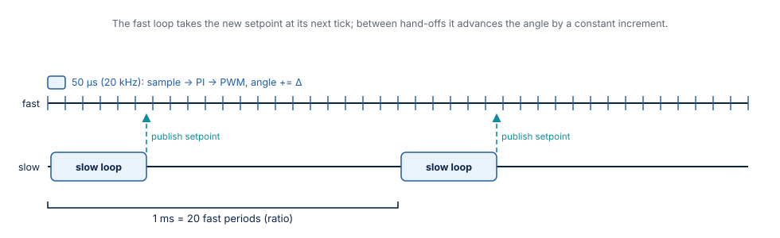
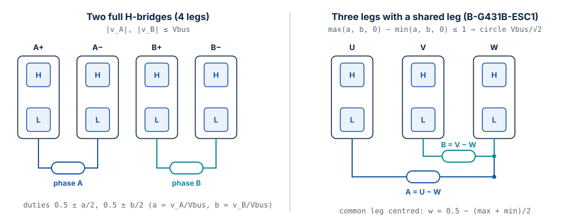
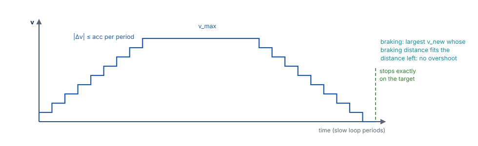
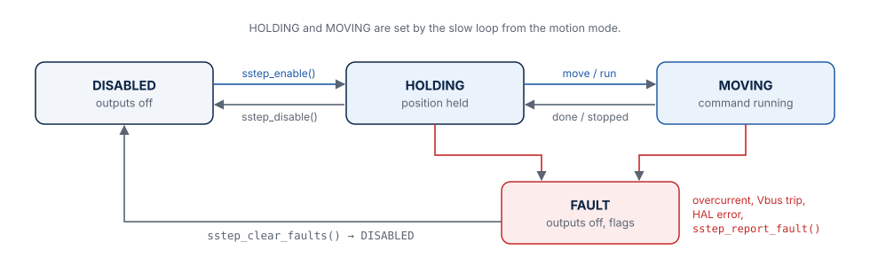

# Control Algorithms

This chapter explains every algorithm of Stepper-C: the timing of the two loops, the
number formats, the current controller, the mapping of the voltage to the power stage
legs, the motion generator and the fault handling. The same algorithms are implemented
in the Scilab prototype (`model/`) and in the Python twins (`tools/`); where the
prototype differs, it says so.

## Two loops and the hand-off

| Loop | Rate (default) | Context | Work |
| --- | --- | --- | --- |
| Fast | `fast_loop_hz` = 20 kHz (PWM frequency) | PWM / ADC interrupt | ADC conversion, trips, current references, PI, feed-forward, voltage limit, leg mapping, `pwm_write()` |
| Slow | `slow_loop_hz` = 1 kHz | main loop or timer task | motion generator, run/hold current, bus voltage scale, setpoint, events |

`fast_loop_hz` must be an integer multiple of `slow_loop_hz`; the ratio (20 by default)
is stored as `ratio`.

**Hand-off.** The slow loop writes a complete setpoint — electrical angle at the start
of its period, angle increment per fast period, current amplitude, back-EMF feed-forward,
bus voltage scale — into the buffer the fast loop is *not* using, then sets
`sp_pending`. The fast loop swaps buffers at its next tick. On a single-core MCU this
needs no lock: the fast loop never reads the buffer being written, and the flag is
cleared before writing.

**Angle interpolation.** Between hand-offs the fast loop adds the increment `Δ` to the
angle every tick, at most `ratio` times; if the slow loop is late, the angle stops
instead of running ahead.

## Numbers: per unit, fixed point and float

All signals inside the loops are **per unit**:

| Quantity | Base | 1.0 pu means |
| --- | --- | --- |
| Current | `i_full_scale_ma` (ADC full scale) | the current at the end of the ADC range |
| Voltage | `vbus_nominal_mv` | the nominal bus voltage |
| Angle | 2³² | one electrical turn |

| Type | Fixed point backend | Float backend |
| --- | --- | --- |
| Signal `sstep_real_t` | Q15 in `int16_t` (−1 … 1) | `float` |
| Accumulator `sstep_acc_t` | Q15 in `int32_t` (±65536 pu) | `float` |
| PI integrator `sstep_integ_t` | Q27 in `int32_t` (keeps increments far below one LSB of Q15) | `float` |
| Gain `struct sstep_gain` | Q15 mantissa + shift exponent | `float` |
| Angle `sstep_angle_t` | `uint32_t`, wraps at one turn | same |

Every operation saturates instead of wrapping, in both backends with identical ranges.
`sstep_init()` derives all gains from the integer configuration without floating point
(2π is taken as 710/113, error 8.5·10⁻⁸). The sine and cosine come from a quarter-wave
table (`SSTEP_CFG_SINE_TABLE_BITS` = 8: 257 entries) with linear interpolation; the
measured error is 1.0 LSB (3.05·10⁻⁵) in fixed point and 4.7·10⁻⁶ in float.

**Microstep angle.** One microstep is `2³⁰ / M` of an electrical turn (four full steps
per turn). The electrical angle of a position is `pos << (14 − log₂ M)` with the
position in 1/65536 microstep; positions therefore wrap exactly at one electrical turn.

## Current references

From the angle $\varphi$ and the amplitude $I$ of the setpoint:

$$
i_A^* = I \cos\varphi, \qquad i_B^* = I \sin\varphi
$$

The amplitude is `i_run_ma` while the motor moves and `i_hold_ma` after `hold_delay_ms`
of standstill (event `SSTEP_EVENT_HOLD_CURRENT`). `sstep_enable()` starts with the run
current.

## Current controller

One PI controller per phase, the same for both:

$$
\begin{aligned}
e_k &= i_k^* - i_k \\
v_k^* &= K_p\,e_k + \mathrm{integ}_k + v_{\mathrm{ff},k} \\
\mathrm{integ}_k &\leftarrow \mathrm{integ}_k + K_i T_s\,e_k + K_b\,\left(v_{k,\mathrm{applied}} - v_k^*\right)
\end{aligned}
$$

with $k \in \{A, B\}$, the integrator state $\mathrm{integ}_k$ and the back-EMF
feed-forward $v_{\mathrm{ff},k}$; the $K_b$ term acts only while the voltage is limited.

| Gain | Formula | 17HS19-2004S1, 1 kHz |
| --- | --- | --- |
| $K_p$ | $L\,\omega_c$ | 18.85 V/A |
| $K_i$ | $R\,\omega_c$ | 10 053 V/(A·s) |
| $K_b$ (back-calculation) | $T_s R / L$ (tracking time $L/R$) | 0.0267 per period |

**Pole-zero cancellation.** The PI zero $K_i/K_p = R/L$ cancels the pole of the R-L phase,
so the closed current loop is first order with the bandwidth $\omega_c = 2\pi \cdot$ `current_bw_hz`
(1 kHz by default; `current_bw_hz` must not exceed `fast_loop_hz / 4`). The computation
delay of one PWM period (the voltage computed now is applied in the next period) adds a
small overshoot: the measured step 0 → 2 A has 1.12 % overshoot, 0.35 ms rise time (90 %)
and 0.40 ms settling time (2 %) with both topologies (test T04).

**Anti-windup.** When the power stage cannot produce the requested voltage, the
difference between the applied and the requested voltage pulls the integrator back with
the gain $K_b$ (back-calculation). The integrator does not wind up during acceleration
into the voltage limit, and the current recovers without overshoot when the limit ends.

**Back-EMF feed-forward.** From the commanded speed (the position change of the slow
period), the slow loop computes the back-EMF amplitude $K_t\,\omega$ and the fast loop adds

$$
v_{\mathrm{ff},A} = -K_t\,\omega \sin\varphi, \qquad v_{\mathrm{ff},B} = K_t\,\omega \cos\varphi
$$

to the controller outputs. The PI then only corrects the residual. With
`ke_uv_s_per_rad = 0` the feed-forward is off.

**Voltage drive.** With `drive_mode = SSTEP_DRIVE_VOLTAGE` there is no current
measurement: $v_k^* = R\,i_k^* + v_{\mathrm{ff},k}$. Torque then drops with speed (the inductance is
not compensated); use it only for boards without current sensing.

!!! note "Known limitation: phase lag at speed"
    The loop follows a rotating reference with a lag that grows with the electrical
    frequency (about 4° at 1 rev/s; at 4 rev/s the current vector error is 0.41 A rms). The amplitude
    stays close to the reference up to the voltage limit (1.97 A at 4 rev/s), but the
    lag shifts the torque angle. A delay compensation (angle advance by one period) is
    planned; an inductive feed-forward $L\,di/dt$ was tried in the prototype and made the
    result worse.

## Voltage limit and leg mapping

The requested phase voltages `(v_A, v_B)` are divided by the measured bus voltage
(`a = v_A / Vbus`, `b = v_B / Vbus`) and mapped to leg duty cycles:

| Topology | Feasible when | Leg duties | Largest circular amplitude |
| --- | --- | --- | --- |
| Two H-bridges, legs `[A+ A− B+ B−]` | `max(|a|, |b|) ≤ 1` | `0.5 + a/2`, `0.5 − a/2`, `0.5 + b/2`, `0.5 − b/2` | `Vbus` |
| Shared leg, legs `[U V W]`, A = U − W, B = V − W | `max(a, b, 0) − min(a, b, 0) ≤ 1` | `a + w`, `b + w`, `w` with `w = 0.5 − (max + min)/2` | `Vbus / √2` |

When the request is not feasible, **both** components are scaled by the same factor:
the voltage vector keeps its direction, so the current — and the torque — keeps its
angle; only its magnitude is limited. The limited flag switches the anti-windup on.

Implementation details: the request is first halved (exact power-of-two pre-scale) until
it is below 4 pu, then multiplied by `V_base / Vbus` (computed once per slow period from
the bus voltage ADC), and a division happens only when the request is limited. The
common leg of the shared topology is centred between the highest and the lowest leg
voltage, which gives the largest circular amplitude. Duties become compare values
`0 … pwm_period_ticks` (0 = low side on).

## Motion generator

The motion generator runs in the slow loop and uses **integers only** in both numeric
backends:

| Quantity | Unit |
| --- | --- |
| Position `pos`, target | 1/65536 microstep (`int64_t`) |
| Velocity `vel`, `v_max` | 1/65536 microstep per slow period (`int32_t`, below 2³⁰) |
| Acceleration `acc`, deceleration `dec` | 1/65536 microstep per period² |

Every period:

1. **Target velocity.** In RUN mode, the requested velocity limited to `v_max`. In MOVE
   mode, the largest velocity `v_new` for which the distance of this period
   $(v + v_{\mathrm{new}})/2$ plus the braking distance $v_{\mathrm{new}}^2 / (2\,\mathrm{dec})$ still fits into the
   distance left `rem`:

    $$
    v_{\mathrm{new}} = \frac{-d + \sqrt{d^2 + 8\,d\,|r| - 4\,d\,|v|}}{2}
    $$

    with $d$ = `dec`, $r$ = `rem`

    (integer square root), or `v_max` when the distance left is larger than the braking
    distance from `v_max` plus one period.
2. **Rate limit.** The velocity moves towards the target by at most `acc` when speeding
   up (larger magnitude, same direction) and at most `dec` otherwise.
3. **Integration.** `pos += floor((v + v_new) / 2)` (trapezoidal rule).
4. **End of a move.** When the position crosses the target, or comes within 64/65536
   microstep of it with `|v_new| ≤ dec`, the position snaps to the target, the velocity
   to zero, the mode to HOLD and `SSTEP_EVENT_MOVE_DONE` is reported.

Properties, all covered by unit tests: no overshoot; the move ends exactly on the target;
the velocity never changes by more than `acc` or `dec` in a period, except in the last
period of a move where at most `2·dec` (a few microsteps per second) drops to zero; a new
target while moving changes the profile smoothly (decelerating with `dec` if it lies
behind). A move of 6400 microsteps with 16 000 µsteps/s and 160 000 µsteps/s² takes
499 periods (T05). The Scilab and Python implementations are bit-exact copies.

The electrical angle increment for the fast loop is
`Δ = trunc(Δpos · 2^(14 − log₂ M) / ratio)`, re-synchronised at every hand-off.

## States and faults

| State | Outputs | Entered by |
| --- | --- | --- |
| `SSTEP_STATE_DISABLED` | off (all legs high impedance) | `sstep_init()`, `sstep_disable()`, `sstep_clear_faults()` |
| `SSTEP_STATE_HOLDING` | on, position held | `sstep_enable()`; slow loop when a command ends |
| `SSTEP_STATE_MOVING` | on, command running | slow loop while a move, run or stop executes |
| `SSTEP_STATE_FAULT` | off | a trip in the fast loop, a callback error, `sstep_report_fault()` |

| Fault flag | Raised when | Where |
| --- | --- | --- |
| `SSTEP_FAULT_OVERCURRENT` (0x0001) | `|i_a|` or `|i_b|` above `i_trip_ma` (current drive only) | fast loop, same period |
| `SSTEP_FAULT_OVERVOLTAGE` (0x0002) | bus voltage above `vbus_max_mv` | fast loop |
| `SSTEP_FAULT_UNDERVOLTAGE` (0x0004) | bus voltage below `vbus_min_mv` | fast loop |
| `SSTEP_FAULT_HAL` (0x0008) | `pwm_write()` or `output_enable()` returned an error | any |
| `SSTEP_FAULT_EXTERNAL` (0x0010) | the application reported a fault | `sstep_report_fault()` |

On a fault the outputs are switched off immediately (`output_enable(false)`), the flags
are stored and `on_fault()` is called from the context that detected it — possibly the
interrupt. Faults stay active until `sstep_clear_faults()`; the driver then returns to
DISABLED and must be enabled again.
