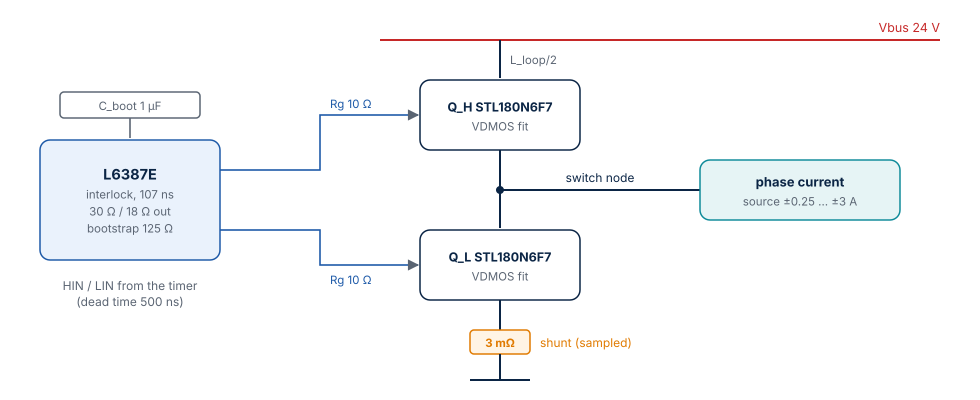
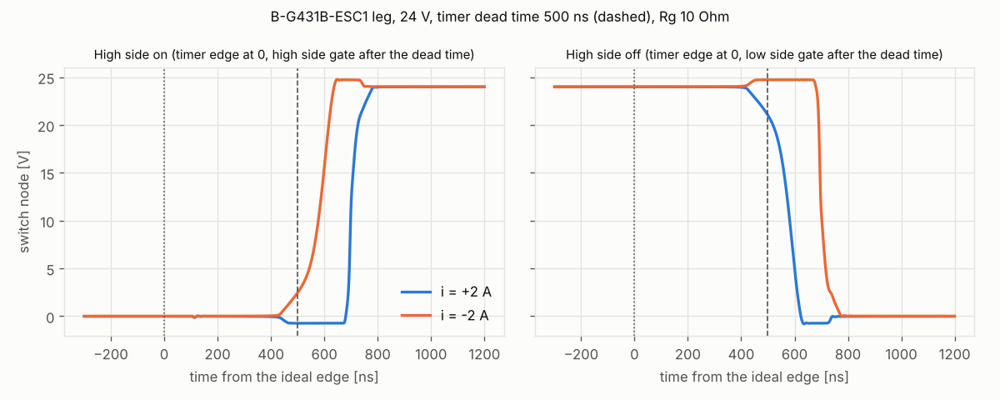
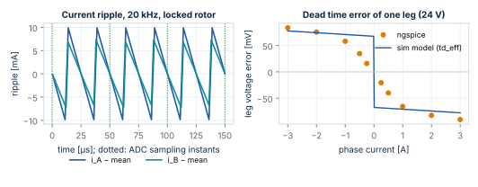

# Power Stage Model

[sfs-stepper-power-spice](https://github.com/AntonVynohradov/sfs-stepper-power-spice) models one half-bridge leg of the B-G431B-ESC1 in ngspice:
the L6387E gate driver, two STL180N6F7 MOSFETs, gate resistors, the bootstrap supply and
the low-side current shunt. It answers the questions an averaged model cannot: how long
the transistors really take to switch, how much of the timer dead time is left, what the
phase voltage loses in the dead time, and when the shunt voltage is valid for sampling.
The results are exported to the simulation.

## The leg circuit

| File | Content |
| --- | --- |
| `models/stl180n6f7_sfs.lib` | STL180N6F7 as an ngspice VDMOS model, fitted by this project to the datasheet |
| `models/l6387_behav.lib` | L6387E behavioural model |
| `circuits/esc1_leg.lib` | subcircuit `ESC1_LEG`: driver, MOSFETs, gate resistors, bootstrap capacitor, shunt, layout inductances |
| `tools/run_tests.py` | test benches SP01–SP03, fit, export |
| `tools/plot_leg.py` | switch node waveforms (`docs/leg_edges.png`) |

The test bench drives the leg with the timer signals of the simulation: a centre-aligned
period from counter peak to counter peak, the high side commanded on in
$\left[\frac{T_s}{2}(1 - d),\ \frac{T_s}{2}(1 + d)\right]$, every turn-on delayed by the timer dead time. The phase is
a constant current source (the 3 mH phase inductance keeps the current almost constant
within 50 µs). Six periods are simulated and the last one is evaluated.

## Device models

**STL180N6F7 (VDMOS).** The ST SPICE model is not part of the repository (its licence is
ST's). The project model uses the ngspice VDMOS device — smooth, with a body diode and a
non-linear gate-drain capacitance — fitted to the datasheet values:

| Quantity | Model (SP01) | Datasheet (typical) |
| --- | --- | --- |
| Rds(on), VGS 10 V, 16 A, 25 °C | 1.903 mΩ | 1.9 mΩ |
| Rds(on) at 100 °C | 2.466 mΩ (×1.30) | — |
| Body diode VSD at 32 A | 0.997 V | ≤ 1.2 V (max) |
| Body diode at 2 A | 0.727 V | — |
| Ciss at VDS 25 V | 4801 pF | 4825 pF |
| Coss at VDS 25 V | 2189 pF | 2240 pF |
| Crss at VDS 25 V | 207 pF | 216 pF |
| Qg, VGS 0 … 10 V, 30 V, 32 A | 78.3 nC | 79.5 nC |

Assumptions: VGS(th) 3.0 V, internal gate resistance 1.2 Ω, diode 0.70 V at 1 A and
1.0 V at 32 A, transit time 2 ns. The switching times of the datasheet (td(on) 33.9 ns,
tr 35.6 ns, td(off) 68.9 ns, tf 42.2 ns) are measured with a stronger gate drive and are
not used as fit targets.

**L6387E (behavioural).** Interlocking (HIN and LIN both high → both outputs low; the
L6387E inserts no dead time of its own), a propagation delay of 107 ns (mean of
ton 110 ns and toff 105 ns), output stages with 30 Ω source and 18 Ω sink resistance
(from the 400 mA / 650 mA short-circuit currents), and the bootstrap DMOS (125 Ω) with
its diode. The logic edges are smoothed and delayed with matched lossless lines, so no
XSPICE is needed.

## Board values and assumptions

The ESC1 user manual does not list the passive values of the power stage. Until they are
read from the schematic (MB1419), the model uses:

| Value | Assumed | Influence |
| --- | --- | --- |
| Timer dead time | 500 ns | the main input; set in the firmware |
| Gate driver supply | 12 V | gate drive strength |
| Gate resistors | 10 Ω, no turn-off diode | turn-off delay, Miller bump |
| Bootstrap capacitor | 1 µF | high-side gate voltage |
| Shunt | 3 mΩ, 1 nH | leg resistance, shunt settling |
| Commutation loop | 3 nH, damped by 1 Ω across each inductance | ringing |

They are the `BOARD` dictionary at the top of `tools/run_tests.py`; change them there and
rerun.

## What happens in the dead time

The figure shows the switch node at both edges for +2 A (current out of the leg) and
−2 A:

- **The high side turns on 700 ns after the ideal edge** for +2 A: 500 ns timer dead time
  + 107 ns driver delay + the time to charge the gate to the Miller plateau. Until then
  the low-side diode holds the node at −0.73 V.
- **For −2 A the node rises already in the dead time**: the low side switches off and the
  phase current itself charges the switch node to the bus (soft switching).
- **The high side turns off slowly**: the gate discharges through 18 Ω + 10 Ω + 1.2 Ω
  from 11 V to the Miller plateau and stays there while the drain voltage changes —
  about 400 ns. The switch node falls 571 ns after the ideal edge for +2 A.

As a result most of the 500 ns timer dead time is consumed by the turn-off of the other
transistor:

| Result | Value | Meaning |
| --- | --- | --- |
| Gap between the driven gates (both below VGS(th) 3 V) | **154 ns** | margin of the dead time; reducing the timer dead time below about 350 ns risks shoot-through |
| Effective dead time of the phase voltage (1–3 A) | **133 ns** | what the step model of the simulation and a future compensation must use |
| Gate of the off switch while the other turns on | **up to 3.73 V** | Cgd·dv/dt against the gate resistor: above VGS(th), a short cross conduction at every edge with the assumed 10 Ω |

## Dead time voltage error

The mean leg voltage over a period differs from the ideal $d\,V_{\mathrm{bus}}$. The simulation uses
the step model

$$
\Delta v_{\mathrm{leg}} = -\operatorname{sign}(i)\,\left(V_{\mathrm{bus}} + 2V_d\right)\frac{t_{d,\mathrm{eff}}}{T_s} - R_{\mathrm{leg}}\,i
$$

with $t_{d,\mathrm{eff}}$ fitted for 1 A ≤ $|i|$ ≤ 3 A (largest deviation 12.8 mV) and
$R_{\mathrm{leg}} = (R_{ds} + R_{ds} + R_{\mathrm{shunt}}) / 2$ = 3.4 mΩ. Below 1 A the real error is smaller: the
phase current charges the switch node capacitance (about 2 × Coss) too slowly to finish
the swing within the dead time — 50 % of the step model at 0.5 A, about 25 % at 0.25 A.
The measured table (`leg_error_table`) is exported for a better compensation later.

| Current | ngspice error | Step model |
| --- | --- | --- |
| −3 A | +83.6 mV | +77.6 mV |
| −2 A | +75.6 mV | +74.2 mV |
| −1 A | +58.1 mV | +70.8 mV |
| −0.5 A | +34.7 mV | +69.1 mV |
| +0.5 A | −40.0 mV | −69.1 mV |
| +1 A | −65.6 mV | −70.8 mV |
| +2 A | −82.6 mV | −74.2 mV |
| +3 A | −90.6 mV | −77.6 mV |

## Shunt sampling

| Case | Shunt at the sampling instant | Ideal $-i\,R_{\mathrm{sh}}$ | Settled (2 %) after the low-side timer edge |
| --- | --- | --- | --- |
| d = 0.5, +2 A | −6.000 mV | −6.000 mV | 345 ns |
| d = 0.5, −2 A | +6.000 mV | +6.000 mV | 344 ns |
| d = 0.9, +2 A | −6.000 mV | −6.000 mV | 345 ns |

The low-side shunt carries the phase current also in the dead time (through the body
diode of the low switch), so the shunt voltage is valid from 345 ns after the low-side
command. With an ADC sampling time of 250 ns before the centre, a centred sample stays
valid up to a **leg duty of 0.956**. With the shared leg at full voltage the largest leg
duty approaches 1; the library does not limit it yet (planned).

## Export to the simulation

`python tools/run_tests.py --export` writes:

| File | Content |
| --- | --- |
| `export/stage_esc1.json` | everything: board values, Rds(on) at 25 and 100 °C, Vd, timer and effective dead time, leg resistance, edge delays, gate gap and bump, error table, shunt settling, largest duty |
| `../sfs-stepper-sim/params/stage_esc1_spice.sci` | Scilab function `stage_esc1_spice()` (generated, do not edit) |
| `../sfs-stepper-sim/params/stage_esc1_spice.json` | the same values for the Python twins |

`board_bg431b_esc1()` takes `dead_ns`, `rds_on` and `vd` from there, and the same
effective dead time is passed to Stepper-C as `dead_time_ns`.

## Tests

| Test | Check | Result |
| --- | --- | --- |
| SP01 | Rds(on) ±5 %, VSD(32 A) ≤ 1.2 V, Ciss/Coss/Crss ±10 %, Qg ±10 % | pass (table above) |
| SP02 | step model within 15 mV for 1–3 A; driven gates never overlap | 12.8 mV; gap 154 ns; gate bump 3.73 V reported |
| SP03 | shunt at the sampling instant within 1 % of `−i·R_sh` | pass, settling 345 ns |

Run time about 40 s (`--quick`: fewer operating points). ngspice options: absolute
tolerances 1 nA / 10 µV (the defaults stall the solver on the quiet gate nodes), maximum
time step 2 ns.
