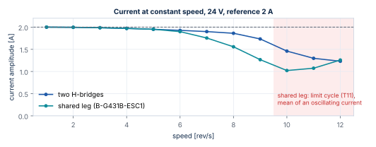
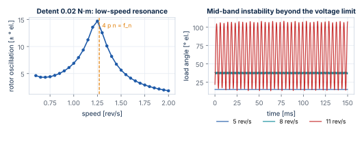

# Results and Design Guidance

This chapter collects what the models say about the 17HS19-2004S1 on the B-G431B-ESC1
at 24 V, and turns it into guidance for configuring the library and the board. All
values come from the tests in the [Test Catalogue](tests.md); the assumptions behind them
(datasheet motor parameters, detent and friction values, board passives) are listed in
[Motor Model](motor-model.md) and [Power Stage Model](power-stage.md).

## Current loop

| Quantity | Value | Test |
| --- | --- | --- |
| Bandwidth (design) | 1 kHz | — |
| Step 0 → 2 A: overshoot / rise (90 %) / settling (2 %) | 1.12 % / 0.35 ms / 0.40 ms | T04 |
| Same with R ×0.9 … 1.3, L ×0.8 … 1.2 | overshoot ≤ 5.2 %, settling ≤ 1.6 ms | T08 |
| Phase lag at 1 rev/s | about 4° | T03, T05 |
| Current ripple at 2 A, locked (20 kHz, 3 mH) | 23 mA p-p | T10 |

The pole-zero cancellation keeps the loop well damped for the whole tolerance range of
the datasheet; a hot winding (R +30 %) with a low inductance slows the last 2 % of the
step to 1.6 ms but does not destabilise it. **Guidance:** 1 kHz bandwidth at 20 kHz PWM
is a safe default; do not exceed `fast_loop_hz / 4` (enforced by `sstep_init()`).

## Voltage limit and speed

| Speed | Two H-bridges: current, scale, load angle | Shared leg (ESC1): current, scale, load angle |
| --- | --- | --- |
| 2 rev/s | 2.00 A, 1.00, 6° | 2.00 A, 1.00, 6° |
| 4 rev/s | 1.97 A, 1.00, 12° | 1.97 A, 1.00, 12° |
| 6 rev/s | 1.93 A, 1.00, 18° | 1.90 A, 0.81, 19–20° |
| 8 rev/s | 1.86 A, 0.97, 24° | 1.56 A, 0.51, 36–39° |
| 9 rev/s | 1.73 A, 0.83, 31° | 1.27 A, 0.46, 48–50° |
| 10 rev/s | 1.46 A, 0.71, 42° | 1.02 A, 0.41, 51–63° (oscillating) |
| 12 rev/s | limit cycle, 16–95° | limit cycle, 3–134° |

(Unloaded rotor, 2 A reference, back-EMF feed-forward on; *scale* is the smallest factor
the power stage applied to the requested voltage, 1 = not limited.)

With three legs the largest circular voltage is `Vbus/√2`: the ESC1 reaches the voltage
limit at about 6 rev/s at 24 V, two H-bridges at about 8 rev/s. Beyond the limit the
current — and the torque — drops with speed, and the load angle grows even without load.

**Guidance:** at 24 V on the ESC1 plan for **at most 8 rev/s** with useful torque
reserve; the torque available at speed `n` is roughly `K_t · I(n)`, minus the angle
already used for acceleration. A higher bus voltage moves every speed in the table up
proportionally (the ESC1 accepts up to 6S LiPo voltages).

## Rotor resonance

**Low-speed resonance.** The rotor on the current vector is a spring-mass system with
`f_n = √(p K_t I / J) / 2π` = 254 Hz at 2 A (248 Hz with the current loop). Any torque
ripple at that frequency excites it. The detent torque has four periods per electrical
period, so it excites the rotor at `4 p n = f_n`, i.e. **about 1.25 rev/s** with the
rotor alone: with an assumed detent torque of 0.02 N·m the oscillation reaches ±14° there
against ±3–5° elsewhere. A load inertia lowers `f_n` (∝ 1/√J) and with it the resonant
speed.

**Mid-band instability.** As long as the current loop controls the current, it damps the
rotor: no oscillation at 5 rev/s. Once the bridge limits the voltage, the drive behaves
like a voltage source and the back-EMF coupling undamps the rotor: ±1.3° at 8 rev/s, a
limit cycle of ±48° at 11 rev/s on the ESC1 (from about 12 rev/s with two H-bridges).

**Guidance:**

- Do not run continuously at the low-speed resonance; accelerate through it. Microstepping
  (M ≥ 16) already removes the full-step excitation; the detent torque remains.
- Keep the operating speed below the voltage limit (previous section) — that is also the
  region where the rotor is damped.
- Measure `f_n` on the real motor (a small angle step, as in T11a) and the detent torque;
  the resonant speed depends on both.
- Active damping in the library (from the back-EMF estimate) is a possible extension.

## Robustness

| Variation | Effect | Test |
| --- | --- | --- |
| R ×0.9 … 1.3, L ×0.8 … 1.2 in the plant, nominal controller | current loop stable, settling ≤ 1.6 ms | T08 |
| 5× load inertia | synchronous at 4 rev/s, 50 rev/s², load angle 13° | T08 |
| 5× inertia + 0.15 N·m load + R ×1.3, L ×0.8 | synchronous, load angle 46° | T08 |
| Load 0.25 N·m at 1 rev/s (below `K_t I` = 0.417 N·m) | synchronous, load angle 37.2° = `asin(T/(K_t I))` | T06 |
| Load 0.5 N·m (above `K_t I`) | loss of synchronism after 152 ms | T06 |

**Guidance:** keep the static load below about 60 % of `K_t I` (0.25 N·m at 2 A) to leave
angle for acceleration; the load angle in the SIL diagram shows the reserve directly.

## Power stage

| Quantity | Value | Consequence |
| --- | --- | --- |
| Effective dead time (timer 500 ns) | 133 ns | phase voltage error ±0.135 V; distortion near the current zero crossing |
| Dead time margin | 154 ns | do not set the timer dead time below about 350 ns without measuring |
| Gate bump of the off switch | 3.7 V with 10 Ω (assumed) | check the real gate resistors / turn-off diodes |
| Shunt valid | 345 ns after the low-side command | sample centred; leg duty ≤ 0.956 |
| Current peak at 4 rev/s incl. ripple | 2.03 A | trip at 3.5 A leaves margin |

## Open points

| Topic | Status | Where |
| --- | --- | --- |
| Measure R, L, `K_t`, detent torque, `f_n` of the real motor | to do (P3) | [Hardware Bring-up](hardware.md) |
| Board passives (Rg, shunt, amplifier gain) from the schematic | to do | [Power Stage Model](power-stage.md) |
| Dead time compensation in the library | planned; value and error table available | `dead_time_ns`, `leg_error_table` |
| Delay compensation (angle advance) | planned | [Control Algorithms](control.md#current-controller) |
| Limit of the leg duty for valid shunt samples | planned | 0.956 from SP03 |
| ADC zero auto-calibration at enable | planned | — |
| Fast loop execution time on the STM32G431 | to measure (P3) | — |
| Scilab run of T08, T10–T12, X04, S01, S04 | pending | [Test Catalogue](tests.md) |
