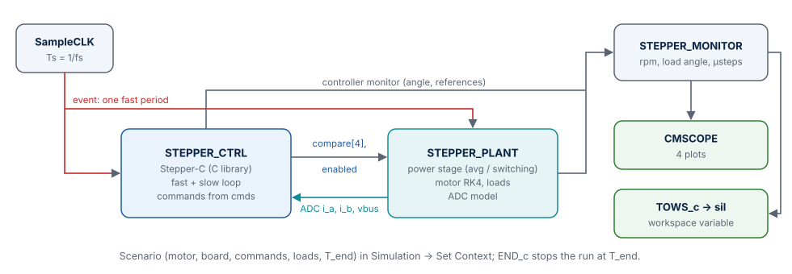

# Software in the Loop

The software-in-the-loop (SIL) diagram runs the **real C code of Stepper-C** — the same
sources that go into the firmware — against the motor model in Xcos. It is the place
where a user without Scilab knowledge sees the library control a motor: open one file,
press Start, watch currents, speed, load angle and position. It is also a test bench:
S01–S04 compare it sample by sample with the Scilab prototype.

## Start here

1. Install Scilab 2027 and, on Windows, Visual Studio 2022 or the free *Build Tools*
   with the workload *Desktop development with C++*.
2. Clone [Stepper-C](https://github.com/AntonVynohradov/Stepper-C) into the folder
   `sfs-stepper-ctrl` next to `sfs-stepper-sim` (or set the environment variable
   `SSTEP_CTRL_DIR` to it).
3. Open **`start_sil.sce`** in Scilab and press **F5**.
4. Xcos opens `xcos/stepper_sil.zcos`. Press **Start** (▶).

The default scenario moves the motor two revolutions (6400 microsteps at 1/16) with
5 rev/s and 50 rev/s² on the B-G431B-ESC1 at 24 V. The scope shows four plots: the phase
currents with their references, the speed in rpm, the load angle in electrical degrees
(above 90° the motor is close to losing steps) and the commanded and real rotor
positions in microsteps.

`start_sil.sce` has two settings at the top:

| Variable | Values | Effect |
| --- | --- | --- |
| `sil_backend` | `"FIXED"` (default), `"FLOAT"` | numeric backend of the compiled library; switching needs a Scilab restart |
| `sil_regenerate` | `%f` (default), `%t` | `%t` builds the diagram again from `xcos/sil_diagram.sci` (needed after a change of the block interfaces) |

## The diagram



| Block | Computational function (C, type 4) | Inputs → outputs | Parameters |
| --- | --- | --- | --- |
| `SampleCLK` | Xcos | → event every `Ts = 1/fs` | `Ts` |
| `STEPPER_CTRL` | `sstep_xcos_ctrl` | ADC `[i_a i_b vbus]` (counts) → `[compare(4) enabled]`, monitor `[φ position velocity state faults iA* iB*]` | `sil_ctrl_rpar(mot, brd, ctl, mp, cmds)` |
| `STEPPER_PLANT` | `sstep_xcos_plant` | `[compare(4) enabled]` → ADC sample, `[iA iB ω θ vA vB |iA|max |iB|max]` | `sil_plant_rpar(mot, brd, loads, locked, 4)` |
| `STEPPER_MONITOR` | `sstep_xcos_monitor` | plant + controller monitor → currents, rpm, load angle, positions, 12 values for the workspace | `[mot.Ns, mp.M]` |
| `CMSCOPE` | Xcos | 4 plots | ranges from the context |
| `TOWS_c` | Xcos | → workspace variable `sil` | buffer `N_log` |
| `END_c` | Xcos | stops at `T_end` | `T_end` |

**What the controller block does.** At initialisation it builds a `struct sstep_config`
from the parameter vector, calls `sstep_init()` (a configuration error stops the
simulation with the library's status text) and `sstep_enable()`. On every clock event it
applies the commands whose time has come, calls `sstep_slow_loop()` every `ratio`
events, converts the ADC input to a `struct sstep_sample`, calls `sstep_fast_loop()` and
outputs the compare values the library wrote through its `pwm_write` callback.

**What the plant block does.** It integrates the motor over one PWM period with the leg
voltages of the *previous* period (the one-period computation delay of the MCU), using
the averaged or the switching power stage (`brd.stage`), applies the load torque steps,
and models the ADC: `counts = round(zero + i / i_full · span)`, clamped to
`0 … adc_full`, and the bus voltage reading.

## Scenario: the diagram context

The scenario is edited in **Simulation → Set Context** and evaluated before each run:

| Variable | Meaning | Example |
| --- | --- | --- |
| `mot` | motor parameters | `mot.Td = 0.02; mot.Tc = 0.01;` (detent, dry friction) |
| `brd` | board and power stage | `brd.topology = "full";` `brd.stage = "switching";` `brd.vbus = 36;` |
| `ctl` | current controller | `ctl.bw_hz = 500;` |
| `mp` | microsteps, speed and acceleration limits, run / hold current | `mp.v_max = 25600; mp.i_run = 1.5;` |
| `cmds` | commands `[t kind value]`: 1 MOVE to (µsteps), 2 RUN (µsteps/s), 3 STOP | `[0 2 12800; 0.15 2 -12800]` |
| `loads` | load torque steps `[t TL]` (N·m) | `[0 0; 0.15 0.25]` |
| `locked` | 1: rotor locked (current loop test) | `1` |
| `T_end` | simulated time (s) | `1.0` |
| `scope_i`, `scope_rpm`, `scope_pos` | scope ranges | `3`, `400`, `7000` |

Lines below `// derived values (do not edit)` compute `Ts` and the workspace buffer size.
A command the library rejects (for example a RUN above `v_max`) stops the simulation with
the command number, its time and the status text.

## Results in the workspace

After a run the variable **`sil`** holds `sil.time` and `sil.values` with one row per PWM
period:

| Column | Quantity | Unit |
| --- | --- | --- |
| 1, 2 | `iA`, `iB` (sampled) | A |
| 3, 4 | `iA*`, `iB*` (references) | A |
| 5 | speed | rpm |
| 6 | load angle | electrical ° |
| 7, 8 | commanded position, rotor position | µsteps |
| 9, 10 | `vA`, `vB` (averaged voltage of the next period) | V |
| 11, 12 | largest `|iA|`, `|iB|` within the period (with the ripple when switching) | A |

```scilab
plot(sil.time, sil.values(:, 6));      // load angle
xtitle("Load angle", "t [s]", "deg el.");
```

## Build and rebuild

`sil_build(backend, force)` copies the library sources and `sil/c/sstep_xcos.c` into
`sil/build/<backend>/`, compiles them with the compiler Scilab finds
(`tbx_build_src`; Visual Studio on Windows, gcc on Linux) with
`-DSSTEP_CFG_MATH_BACKEND=…`, and links the shared library. The build happens once; it
is repeated automatically when any source file differs from its copy in the build folder.
`sil/build/` is ignored by Git.

The library is searched in this order: `SSTEP_CTRL_DIR`, the submodule
`ext/sfs-stepper-ctrl`, the sibling folder `../sfs-stepper-ctrl`.

## Agreement with the prototype

| Test | Scenario | Criterion | Result |
| --- | --- | --- | --- |
| S01 | current step 0 → 2 A, locked rotor | currents within 5 mA of the prototype | fix of an empty-command case applied; result of the re-run pending |
| S02 | move 640 µsteps | currents < 5 mA, commanded angle identical, rotor < 0.05 µstep | 1.05 mA, angle identical, rotor 0.0075 µstep |
| S03 | 8 rev/s, both topologies | current amplitude as the prototype (T09) ± 30 mA | 1.862 A (two H-bridges), 1.557 A (shared leg), equal to the prototype |
| S04 | run 4 rev/s with the switching stage | currents and peak current within 5 mA | new in this version; first run pending (the C plant equals the Python twin to 4·10⁻¹⁶) |

The remaining difference comes from the quantisation the prototype does not have: ADC
counts, Q15 arithmetic and integer compare values.

## Troubleshooting

| Symptom | Cause | Remedy |
| --- | --- | --- |
| "No C compiler found by Scilab" | Visual Studio / Build Tools missing | install the C++ workload, restart Scilab |
| "Stepper-C sources not found" | library not next to the simulation | set `SSTEP_CTRL_DIR` |
| "wrong parameter vector (use sil_plant_rpar)" | diagram older than the blocks | set `sil_regenerate = %t` once, or delete `xcos/stepper_sil.zcos` |
| Changes in the C code have no effect | the old DLL is still loaded | restart Scilab (the build is redone automatically) |
| "The FIXED library is already linked … Restart Scilab to switch to FLOAT" | backend changed in a running session | restart Scilab |
| "Stepper-C: sstep_init failed: …" | configuration rejected by the library | the message names the status; check the context values |
| Link warnings when the diagram is generated | Xcos versions before the fix of the scope ports | regenerate the diagram with the current `sil_diagram.sci` |
