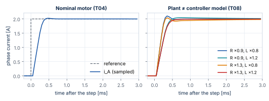
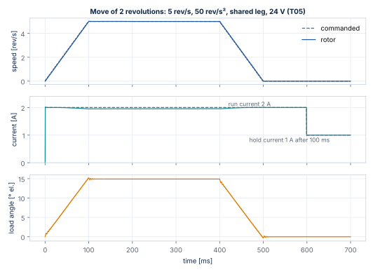
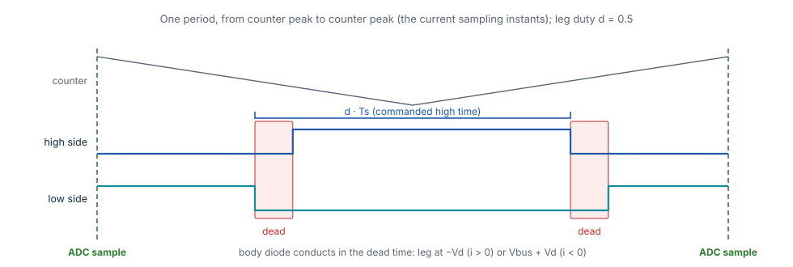

# Simulation

[sfs-stepper-sim](https://github.com/AntonVynohradov/sfs-stepper-sim) is the Scilab/Xcos environment in which every algorithm of Stepper-C is
first developed and later verified: the motor model, a Scilab prototype of the control
loops, an averaged and a switching power stage, the software-in-the-loop diagram and
Python twins of everything. This chapter covers the Scilab side; the Xcos diagram has
its own chapter, [Software in the Loop](sil.md).

## Repository layout

| Folder / file | Content |
| --- | --- |
| `loader.sce` | loads every function (`getd` of `params`, `model`, `sil`, `xcos`, `xcos/blocks`) and the Xcos libraries |
| `params/` | parameter functions: motor, board, controller, motion, ngspice stage values |
| `model/` | motor equations, solvers, power stages, current loop, motion generator, references, SIL parameter builders |
| `sil/` | C sources of the Xcos blocks (`sil/c/sstep_xcos.c`), build script, library lookup |
| `xcos/` | diagram generator `sil_diagram.sci`, block interfaces `xcos/blocks/*.sci` |
| `start_sil.sce` | builds the library and opens the SIL diagram |
| `tests/` | `run_all.sce`, test scripts, helpers, reference data `tests/reference/*.csv` |
| `tools/` | Python twins `ref_model.py`, `ref_ctrl.py`, `ref_motion.py`, `ref_switching.py`, `ref_ext.py` |
| `demos/` | scripts with plots: open loop, switching stage |

Start every session with

```scilab
exec("loader.sce", -1);
```

## Parameters

Parameters are Scilab structures returned by functions, so a scenario changes a field
without editing a file.

| Function | Content |
| --- | --- |
| `motor_17hs19_2004s1()` | `R`, `L`, `I_rated`, `Kt`, `Ns`, `Td`, `J`, `B`, `Tc`, `w_c` (see [Motor Model](motor-model.md#parameters-of-the-17hs19-2004s1)) |
| `board_bg431b_esc1()` | `vbus` 24 V, `topology` `"shared"`, `fs` 20 kHz; trips and ADC scaling for the SIL; `stage` `"avg"`/`"switching"`, `dead_ns`, `rds_on`, `vd`, `sw_nstep` |
| `stage_esc1_spice()` | generated by ngspice: `rds_on`, `r_leg`, `vd`, `dead_timer_ns`, `dead_eff_ns`, `shunt_settle_ns`, `duty_max_sampling` |
| `ctrl_default()` | `bw_hz` 1000, `delay` 1 (computation delay, as on the MCU), `ff` 1 (back-EMF feed-forward), `nsub` 4 (RK4 steps per period) |
| `motion_default()` | `M` 16, `f_slow` 1000 Hz, `v_max` 16 000 µsteps/s, `acc`/`dec` 160 000 µsteps/s², `i_run` 2 A, `i_hold` 1 A, `hold_delay` 0.1 s |

## Open-loop motor simulation

`stepper_simulate(mot, src, srcp, t, x0, locked)` integrates the motor with lsoda for a
voltage source `u = src(t, x, srcp)` returning `[v_A; v_B; T_L]`:

```scilab
mot = motor_17hs19_2004s1();
srcp = struct("V", mot.R * mot.I_rated, "f_el", 5, "TL", 0);   // rotating voltage, 5 Hz el.
t = 0:1e-4:0.4;
x = stepper_simulate(mot, src_open_loop, srcp, t);              // x = [iA; iB; w; theta]
plot(t, x(1, :), t, x(2, :));
```

Sources: `src_dc` (constant voltages and load) and `src_open_loop` (rotating voltage
vector). `demos/demo_open_loop.sce` plots currents, speed and load angle.

## Closed-loop prototype

`sim_closed_loop` is the discrete prototype of the Stepper-C fast loop, run period by
period exactly in the order of the MCU: sample the currents, compute the references and
the controller, apply the voltage computed in the previous period (`c.delay = 1`) for one
period, integrate the motor.

```scilab
[rec, st, ext] = sim_closed_loop(mot, brd, c, ref, refp, T, locked, st)
```

| Argument | Meaning |
| --- | --- |
| `mot`, `brd`, `c` | motor, board, controller; `c.mot` (optional) is the motor the controller is tuned for, if different from the plant |
| `ref`, `refp`, `st` | reference function `[r, st] = ref(t, refp, st)` returning `[I; φ; ω_ref; T_L]`, its parameters and state |
| `T` | simulated time [s] |
| `locked` | `%t`: rotor locked (current loop tests) |
| `rec` | one row per period: `t iA iB w θ iA_ref iB_ref vA vB k I φ` (`k` = power stage scale, 1 = not limited) |
| `ext` | one row per period: `iA_min iA_max iB_min iB_max vA_mean vB_mean` (switching stage: within the period) |

Reference functions:

| Function | Reference |
| --- | --- |
| `ref_current_step` | constant angle, current step `I0 → I1` at `t_step` |
| `ref_const_speed` | constant current, constant electrical frequency |
| `ref_speed_ramp` | constant current, speed ramp to `rev_s` in `t_ramp`, optional load `TL` |
| `ref_angle_step` | constant current, angle step `0 → φ1` (rotor natural frequency) |
| `ref_motion` | the motion generator: commands `[t kind value]` (see below) |

Example — current step on a locked rotor, the test T04:

```scilab
mot = motor_17hs19_2004s1(); brd = board_bg431b_esc1(); c = ctrl_default();
refp = struct("I0", 0, "I1", 2, "t_step", 1e-3, "phi", 0);
rec = sim_closed_loop(mot, brd, c, ref_current_step, refp, 6e-3, %t);
plot(rec(:, 1), rec(:, 2), rec(:, 1), rec(:, 6));     // iA and its reference
```



## Motion generator twin

`motion_init`, `motion_slow` and `motion_step` reproduce the integer motion generator of
Stepper-C bit for bit (`model/sim_int.sci` provides C-style integer division and square
root). `ref_motion` turns it into a reference: it calls the slow loop every `ratio` fast
periods and interpolates the angle exactly like the library.

| Command `[t kind value]` | Meaning |
| --- | --- |
| kind 1 MOVE | move to `value` microsteps |
| kind 2 RUN | run at `value` microsteps/s |
| kind 3 STOP | decelerate to standstill |
| kind 4 LOAD | load torque `value` N·m from time `t` (simulation only) |

```scilab
mp = motion_default();
st = motion_init(mot, brd, mp, [0, 1, 6400]);          // move 2 revolutions at t = 0
[rec, st] = sim_closed_loop(mot, brd, c, ref_motion, [], 0.6, %f, st);
// st.hist: [t pos v vel_q16 mode] per slow period
```



The figure shows the test T05: the rotor follows the commanded speed with a load angle
of 15° at 50 rev/s² (inertia of the rotor only), the run current drops to the hold
current 100 ms after the move, and the move ends exactly on 6400 microsteps after 499 ms.

## Power stage models

| `brd.stage` | Model | Use |
| --- | --- | --- |
| `"avg"` (default) | each leg delivers `duty · Vbus` (`bridge_avg`) | fast; all control tests |
| `"switching"` | `bridge_switching.sci`: centre-aligned legs, turn-on delayed by the dead time, body diode in the dead time (`−Vd` or `Vbus + Vd` by current direction), `Rds(on)`; RK4 between the switching instants (`stepper_period_sw`) | ripple, peak current, dead time distortion; about 5× slower |



The period starts at the counter peak (all low sides on, the sampling instant); the
high side of a leg with duty `d` is commanded on in `[Ts/2 (1 − d), Ts/2 (1 + d)]`. A
pulse shorter than the dead time disappears. With all outputs disabled every leg is in
the dead state (only the diodes conduct).

With ideal switches the switching model gives the same sampled currents as the averaged
model within 0.01 mA (test T10). The dead time changes the mean phase voltage by
`−2 sign(i) (Vbus + 2 Vd) td / Ts`; the stage values come from ngspice
(`stage_esc1_spice()`: effective dead time 133 ns, leg resistance 3.4 mΩ, diode 0.73 V).

```scilab
brd.stage = "switching";
sp = struct("I", 2, "rev_s", 4, "t_ramp", 0.05, "Ns", mot.Ns);
[rec, st, ext] = sim_closed_loop(mot, brd, c, ref_speed_ramp, sp, 0.15);
peak = max(abs(ext(:, 1:4)));                   // largest current including the ripple
```

`demos/demo_switching.sce` plots the sampled current with its ripple band, the ripple
per period and the dead time voltage error.

## Python twins

Every Scilab algorithm has a Python twin in `tools/`. The twins are independent
implementations used to cross-check the Scilab code (tests X01–X04), to prototype tests
quickly and to generate the reference CSV files.

| Twin | Covers | Run |
| --- | --- | --- |
| `ref_model.py` | motor model (scipy Radau), T00–T02, X01 reference | `python tools/ref_model.py [--write]` |
| `ref_ctrl.py` | averaged stage, PI loop, B01, T03, T04, X02 reference | `python tools/ref_ctrl.py [--write]` |
| `ref_motion.py` | integer motion generator (bit-exact with C), T05–T07, T09, X03 reference | `python tools/ref_motion.py [--write]` |
| `ref_switching.py` | switching stage, T10, X04 reference | `python tools/ref_switching.py [--write]` |
| `ref_ext.py` | T08, T11, T12 | `python tools/ref_ext.py` |

`--write` regenerates the reference files in `tests/reference/`. Requirements:
`numpy`, `scipy`.

## Running the tests

```scilab
exec("tests/run_all.sce", -1);
```

The runner executes every test script with error catching, prints `PASS`/`FAIL` lines
with the measured values and a failure count, and exits with status 1 in batch mode
(`scilab-cli -f tests/run_all.sce`) when a test fails. Test variables use the prefix
`rt_` so that test scripts cannot overwrite them. The complete list with the pass
criteria is in the [Test Catalogue](tests.md).

## Adapting the model to another motor or board

1. Copy `params/motor_17hs19_2004s1.sci` to a new function with the values of your motor
   (`R`, `L`, `I_rated`, `Kt`, `Ns`, `J`), or change the fields in a script.
2. Copy `params/board_bg431b_esc1.sci` for another board: bus voltage, topology
   (`"full"` or `"shared"`), PWM frequency and period, trip levels, ADC scaling.
3. Run T01–T04 first (electrical model and current loop), then the motion tests.
4. For the switching stage, set `dead_ns`, `rds_on`, `vd` from your power stage (or
   adapt the ngspice model and export).
