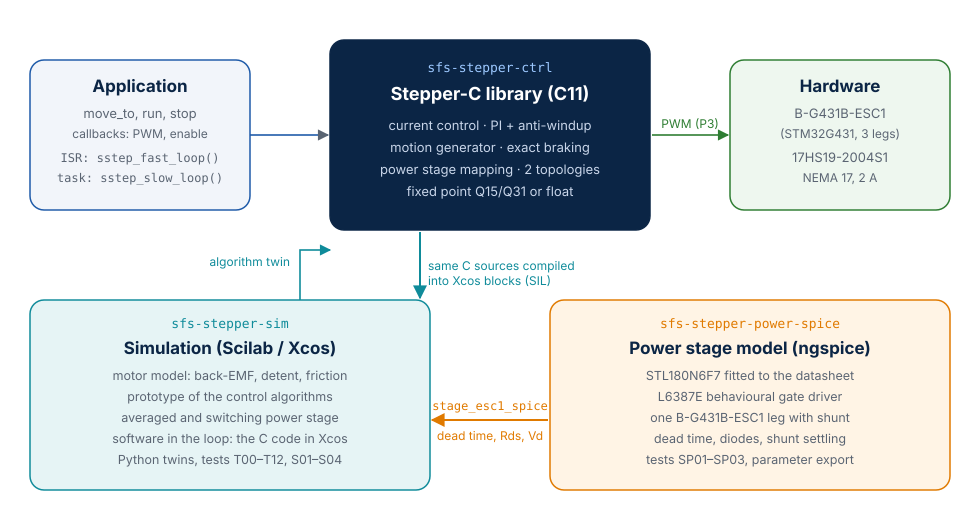
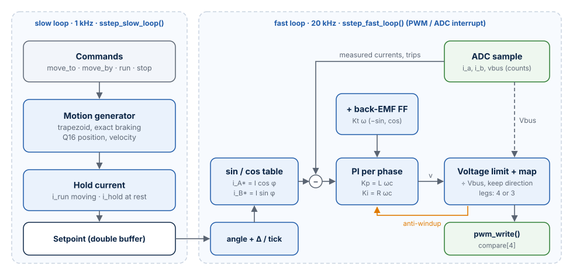
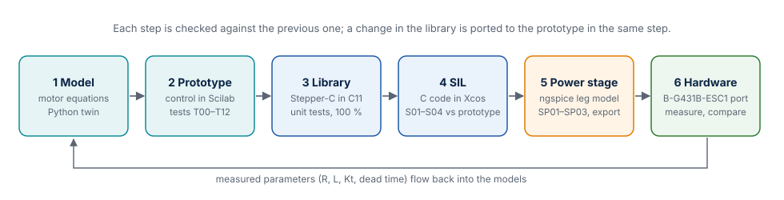

# System Architecture

This chapter shows how the library, the simulation and the power stage model fit
together, which data flows between them, and the development workflow that keeps them
consistent. The individual modules are described in their own chapters.

## The three repositories



| Part | Role in the system | Gives to the others | Takes from the others |
| --- | --- | --- | --- |
| **Stepper-C** ([GitHub](https://github.com/AntonVynohradov/Stepper-C), folder `sfs-stepper-ctrl`) | The product: control loops for the MCU | C sources compiled into the Xcos blocks | Algorithms first proven in the prototype; dead time value for compensation |
| **Simulation** ([sfs-stepper-sim](https://github.com/AntonVynohradov/sfs-stepper-sim)) | Motor model, prototype of every algorithm, SIL test bench | Reference results, limits (speed, resonance, robustness) | The library sources (SIL); the switching stage parameters from ngspice |
| **Power stage model** ([sfs-stepper-power-spice](https://github.com/AntonVynohradov/sfs-stepper-power-spice)) | Transistor-level view of one ESC1 leg | `params/stage_esc1_spice.sci` / `.json`: effective dead time, leg resistance, diode drop | Board values (gate resistors, shunt, dead time) |
| **Hardware** (B-G431B-ESC1 + 17HS19-2004S1) | The target of the first port (P3) | Measured R, L, Kt, dead time, gate waveforms | The library and its configuration |

The repositories are independent Git repositories that sit next to each other:

```text
sfs-stepper/
├── sfs-stepper-ctrl/          Stepper-C library
├── sfs-stepper-sim/           Scilab/Xcos model, SIL, Python twins
├── sfs-stepper-power-spice/   ngspice model of the power stage
└── sfs-stepper-article/       this manual (website + PDF), repository Stepper-C-Motor-Control-Library
```

The simulation finds the library through the environment variable `SSTEP_CTRL_DIR`, a
Git submodule `ext/sfs-stepper-ctrl`, or the sibling folder `../sfs-stepper-ctrl` (in
that order). The ngspice runner writes its export into `../sfs-stepper-sim/params/`
when that folder exists.

## Signal chain



From a command to a turning shaft:

1. The application calls `sstep_move_to()` (or `sstep_run()`, `sstep_stop()`).
2. Every slow loop period (1 ms) the **motion generator** advances the position with the
   acceleration and velocity limits, chooses the current amplitude (run or hold) and
   publishes a **setpoint**: the electrical angle at the start of the period, its
   increment per fast period, the current amplitude and the back-EMF feed-forward.
3. Every fast loop period (50 µs at 20 kHz) `sstep_fast_loop()` converts the ADC counts
   to currents, checks the trip levels, computes the current references
   `I cos φ`, `I sin φ`, runs one **PI controller per phase**, adds the feed-forward,
   limits and maps the voltage vector to the legs of the topology and calls
   `pwm_write()`.
4. The **power stage** applies the leg voltages; the **motor** turns the phase currents
   into torque; the ADC samples the currents at the centre of the next PWM period.

The same chain exists three times — in C (the library), in Scilab (the prototype) and in
Python (the twin) — and the three are compared sample by sample.

## How the parts are verified against each other

| Comparison | Test | Agreement |
| --- | --- | --- |
| Scilab motor model ↔ Python model (scipy, Radau) | X01 | 4·10⁻⁸ A |
| Scilab closed loop ↔ Python closed loop | X02, X03 | 5·10⁻¹³ A |
| Scilab motion generator ↔ C motion generator | `tools/ref_motion.py` against `src/sstep_motion.c` | bit-exact over 3 052 885 periods |
| C library in Xcos ↔ Scilab prototype | S01–S04 | S02, S03: currents within 1.05 mA (ADC step 1.95 mA), commanded angle identical; S01, S04: re-run pending |
| Scilab switching stage ↔ Python switching stage ↔ C plant block | X04, host check | 4·10⁻¹⁶ (C ↔ Python) |
| ngspice device model ↔ STL180N6F7 datasheet | SP01 | Rds(on), Ciss, Coss, Crss, Qg within 10 % |
| C unit tests with a motor model ↔ Scilab prototype | `gtest_sstep_loop.cpp` | current step 1.11 % overshoot (prototype 1.12 %) |

## Development workflow



The work follows the order of the figure, and each step is checked against the previous
one before the next starts:

1. **Model.** The motor equations are written once (`stepper_motor_f`) and checked
   against analytic results (T00–T02) and an independent Python solver (X01).
2. **Prototype.** Each control algorithm is first written in Scilab and tested on the
   model (T03–T12).
3. **Library.** The algorithm is implemented in C11 for both numeric backends, with unit
   tests and 100 % coverage.
4. **Software in the loop.** The C code runs in Xcos against the same model; S01–S04
   must match the prototype.
5. **Power stage.** ngspice extracts the switching parameters of the real board; the
   simulation uses them.
6. **Hardware.** The library is ported to the B-G431B-ESC1; measured motor and board
   values flow back into the models.

!!! note "Rule: the prototype follows the library"
    The Scilab prototype always implements the *current* algorithm of the library. A
    change in Stepper-C is ported to the prototype and to its Python twin in the same
    step, so that the SIL comparison compares identical algorithms.

## Hardware reference

| Item | Part | Key data |
| --- | --- | --- |
| Motor | StepperOnline 17HS19-2004S1 (NEMA 17) | 2 phases, 200 steps, 1.60 Ω, 3.0 mH, 2.0 A, 0.59 N·m, 82 g·cm² |
| Board | STMicroelectronics B-G431B-ESC1 | STM32G431CB (Cortex-M4F, 170 MHz), 3 half-bridges, L6387E drivers, STL180N6F7 MOSFETs (60 V), three low-side shunts |
| Connection | Shared leg | phase A between U and W, phase B between V and W |
| Supply | Laboratory supply | 24 V nominal (the board accepts 3S … 6S LiPo voltages) |

With three legs the largest sinusoidal phase voltage is `Vbus/√2` (17.0 V at 24 V)
instead of `Vbus` with two H-bridges; the consequences are measured in
[Results](results.md#voltage-limit-and-speed).
